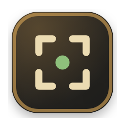

# puuush

Снимок области экрана и ссылка на него в буфере обмена. Нажал горячую клавишу,
протянул рамку, нажал Enter, ссылка уже в буфере, вставляешь её в чат.

Приложение живёт в трее, главного окна нет. macOS, Windows, Linux.

Сервер не обязателен. Без него файлы уходят на публичные хостинги. С ним лежат
на твоём домене, и в режиме «только свой сервер» никуда больше не уходят. Как
поднять свой сервер, написано в [server/README.md](server/README.md).




## Интерфейс

Два окна, и всё. Первое появляется само, второе открывается из трея.

**Выбор области.** Снимок экрана под затемнением. Выделенная рамка остаётся
чистой, над ней написан размер будущей картинки.

**Настройки.** Хоткей, куда загружать, поведение.


Если файл настроек не читается, окно говорит об этом прямо и не подставляет
значения по умолчанию молча.


## Как это работает

```
⌘⇧S (Ctrl+Shift+S) → рамка → Enter → *ding* → ⌘V (Ctrl+V)
```

1. Скриншот берётся до появления окна выбора. Иначе окно попало бы в кадр,
   и область пришлось бы выбирать на снимке, где видно то же самое окно.
2. Область вырезается из исходного снимка, а не из того, что нарисовано в
   окне. На Retina в файл попадает реальное разрешение.
3. Файл уходит на хостинг, ссылка проверяется настоящим запросом и ложится
   в буфер.

## Установка

Нужен Node 22, как в CI. Из исходников:

```bash
npm ci
npm start
```

Установщик собирается командами `npm run dist:linux`, `dist:mac` или `dist:win`,
результат в `dist/`. `dist:mac` работает только на macOS, `dist:win` только на
Windows, подробнее в [Сборка в GitHub Actions](#сборка-в-github-actions).

Сборки не подписаны, поэтому система при первом запуске ругается:

- macOS: «Системные настройки», «Конфиденциальность и безопасность», внизу «Всё равно открыть». Кнопка появляется после первого неудачного запуска. Если её нет, запусти ещё раз. Щелчок с Control в macOS Sequoia больше не помогает.
- Windows: в окне SmartScreen «Подробнее», потом «Выполнить в любом случае». На Windows 11 с включённым Smart App Control неподписанное приложение могут блокировать без кнопки обхода. Тогда нужна подписанная сборка.
- Linux: `chmod +x puuush-*.AppImage` и запуск. Либо `sudo apt install ./puuush_*.deb`.

На Linux глобальная горячая клавиша и трей работают не везде. Под Wayland (GNOME, KDE) хоткей может не сработать: Electron получает клавиши через портал, а портал есть не везде. Надёжно работает сессия X11, а для скриптов есть `puuush --cli`. Иконка в трее на GNOME нужно расширение AppIndicator и пакет libappindicator.

## Настройки

Открываются из трея: правый клик по иконке, «Настройки…».

Всё применяется сразу, отдельной кнопки «Сохранить» нет.

Настройки и история лежат в `settings.json` и `history.json` в папке данных
приложения: `~/.config/puuush/` на Linux, `~/Library/Application Support/puuush/`
на macOS, `%APPDATA%\puuush\` на Windows.

Если хоткей занят другим приложением, puuush скажет об этом при запуске и
откроет окно настроек. Молча не работать он не станет.

Глобальная комбинация перехватывает нажатие раньше активной программы. Поэтому
`Ctrl+Shift+S` (⌘⇧S на macOS) по умолчанию не даст работать «Сохранить как» в
тех программах, где она на этой комбинации, пока открыт puuush. Если это мешает,
поменяй комбинацию в настройках. Свободная, например `⌘⌥S`, занята крайне редко.

## Локальные копии

Каждый снимок и картинка из буфера сохраняются на диск. Если загрузка не удалась
или хостинг потом удалил файл, локальная копия остаётся. Лежат они в
`Pictures/puuush` (на Linux и macOS это `~/Pictures/puuush`), папку можно сменить
в поле «Папка для скринов».

Галочка «Хранить снимки на диске» выключает копии. Тогда файл удаляется сразу
после попытки загрузки, успешной или нет.

## Куда загружать

По умолчанию режим «авто»: приложение идёт по списку и берёт первый хостинг,
который отдал рабочую ссылку. Первым пробуется свой сервер, если он настроен,
дальше catbox, pomf2 и uguu. Ссылка проверяется настоящим запросом. Хостинг
может принять файл и отдать битую ссылку, и тогда приложение молча идёт
дальше.

Проверка идёт GET-запросом с Range, а не HEAD. HEAD не годится: catbox на
несуществующий файл отвечает на HEAD кодом 200, а на GET отдаёт 404. По самой
ссылке приложение сверяет первые байты и размер с локальным файлом.

| Хостинг | Ссылка живёт | Нужен аккаунт |
|---|---|---|
| catbox.moe | два года без обращений (анонимные файлы) | нет |
| pomf2.lain.la | пока работает, но в поиске есть сообщения о закрытии | нет |
| uguu.se | три часа | нет |
| свой сервер | пока лежит на сервере, по умолчанию 30 дней | свой домен |

Catbox может отбрасывать загрузки с датацентровых адресов. Если сервер стоит в
дата-центре, а своего нет, часть загрузок может не пройти. С домашнего компьютера
такого не бывает.

Что вычеркнуто из списка и почему, проверено отправкой настоящего файла
2026-10-17:

- `0x0.st` отключил загрузки, хостинг объясняет лавиной ботов
- `litterbox.catbox.moe` отвечает HTTP 412 «No file!»
- `file.io` отвечает редиректом вместо ссылки
- `puu.sh` жив, но больше не анонимный, требует puush-токен из аккаунта

### Свой сервер

В репозитории лежит готовый сервер: он принимает файл по
`POST /v1/uploads`, кладёт на диск и отдаёт по короткой ссылке. Подробности,
развёртывание и API в [server/README.md](server/README.md).

Ключ передаётся заголовком, а не в URL. Иначе он попал бы в access-лог
веб-сервера открытым текстом на каждой загрузке.

Ссылка на файл публичная, защита в неугадываемости: `id` это 12 случайных
байт, перебрать их невозможно.

Режим «авто» уводит файл во внешний хостинг, если свой сервер отказал. Об этом
приложение говорит отдельно, потому что это понижение приватности: скриншот
уехал в публичный интернет вместо своего сервера. Если такого быть не должно,
поставь режим «только свой сервер»: там любой сбой виден сразу и файл наружу не
уходит.

## Сборка в GitHub Actions

Собирается нативно на раннере каждой ОС, кросс-сборки нет: `dmg` требует
macOS, `nsis` требует Windows. Workflow лежит в
`.github/workflows/build.yml`, стартует по тегу `v*` или вручную, артефакты
кладёт в выдачу джобы.

Про образы раннеров важно: Intel-машина для macOS называется
`macos-15-intel`, и она последняя такая, её уберут в августе 2027-го. Образа
`macos-13` на хостед-раннерах не существует, джоба с ним не упадёт, а навсегда
зависнет в очереди в ожидании машины, которой нет.

```bash
npm run dist:mac     # dmg, arm64 + x64, только на macOS
npm run dist:win     # установщик nsis, только на Windows
npm run dist:linux   # AppImage и .deb
```

Иконки лежат в `assets/` готовыми. Исходник один, `assets/icon.svg`, а
`assets/trayTemplate.svg` для трея на macOS. Пересобрать PNG, ICO и ICNS:
`npm run icons`. Нужен только Electron, он уже стоит после `npm ci`.

## Из командной строки

```bash
puuush --cli ~/Desktop/screen.png
```

Печатает ссылку в stdout, отчёт по шагам в stderr. Работает, даже когда
приложение уже висит в трее, поэтому годится для cron и pre-commit.

На машине без дисплея Electron не стартует, и обёртка нужна обязательно:

```bash
xvfb-run -a puuush --cli ~/screen.png
```

Без неё приложение выведет это объяснение и выйдет с кодом 2.

## Диагностика

```bash
puuush --selftest
```

Прогоняет на себе всё, что нельзя проверить чтением кода: берёт экран, режет
область, создаёт трей, занимает хоткей, загружает файл, открывает оба окна и
собирает ошибки в них. Годится после обновления Electron и в вечерней
проверке, что всё ещё живо.

Экран ему тоже нужен, поэтому на сервере без монитора так же через
`xvfb-run -a`. В CI без дисплея прогонать его нельзя.

```
  ОК    захват экрана        2560x1440 px, scale 2
  ОК    нарезка и запись      640x360 -> /home/user/Pictures/puuush/selftest.png
  ОК    трей                 иконка загружена
  ОК    хоткей               CommandOrControl+Shift+S занят
  ОК    загрузка             https://files.catbox.moe/xxxxx.png (catbox)
  ОК    окно настроек        грузится без ошибок
  ОК    окно выбора области  грузится без ошибок
```

Возвращает ненулевой код, если хоть одна строка с ошибкой. Годится для
мониторинга в cron.

## Как устроено

```
src/
  main.js       трей, хоткей, IPC, режимы --cli и --selftest
  capture.js    снимок экрана и окно выбора области
  overlay.*     прозрачное окно с рамкой
  upload.js     хостеры, откат, проверка ссылки
  store.js      настройки и история в JSON, в папке данных приложения
  settings.*    окно настроек
  preload.js    мост из renderer в main
server/
  index.js      приём файлов, учёт, уборка
  Dockerfile    образ сервера, см. server/README.md
```

Нативных модулей нет намеренно. Иначе три отдельные сборки вместо одной.
Захват делает `desktopCapturer`, выбор области собственным прозрачным окном.

`contextIsolation` включён, `nodeIntegration` выключен. Renderer получает
ровно те функции, что перечислены в `preload.js`, и никакого доступа к Node.

Состояние лежит в `settings.json` и `history.json` в папке данных, пути в
разделе «Настройки». Без базы: переносится копированием файла и читается глазами.

## Осторожно

Все хостинги кроме своего сервера публичные и без пароля. Ссылку открывает
кто угодно, кто её получил. Для скриншотов интерфейса и отчётов это нормально.
Личные данные, ключи, содержимое `.env` и чужие личные сообщения выкладывать
наружу не стоит, для таких случаев нужен свой сервер на своём домене.

Файлы копятся. Старые скриншоты обычно никому не нужны, сервер сам режет их
по возрасту и по квоте.

## Лицензия

MIT, см. [LICENSE](LICENSE).