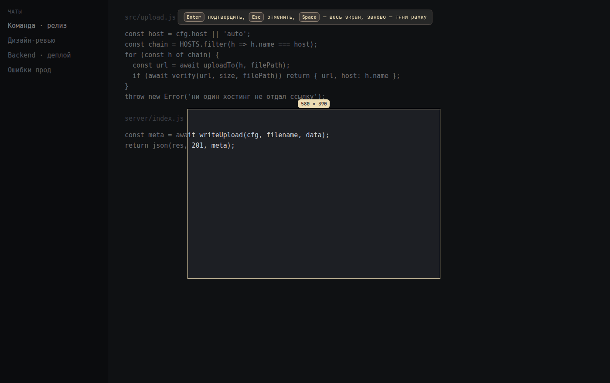
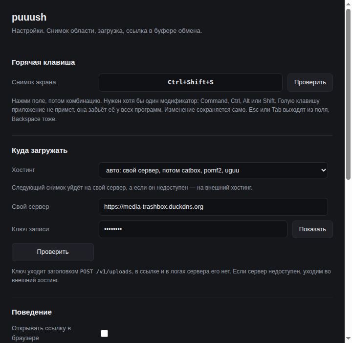
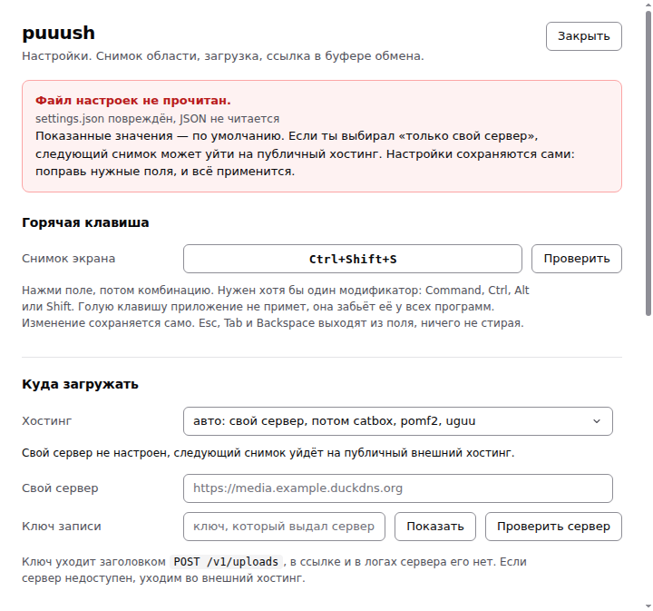
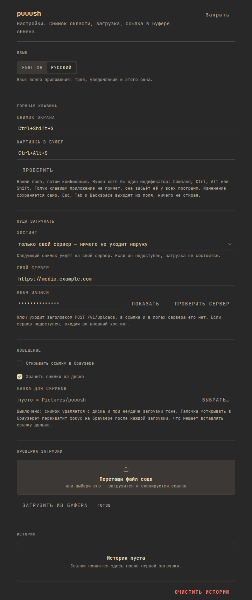

# puuush

Screenshot a region of the screen, upload it, and get the link in your
clipboard. Press the hotkey, drag a frame, press Enter, and the link is
already in the clipboard, ready to paste into a chat.

The site with the pictures and the download table:
[aa-blinov.github.io/puuush](https://aa-blinov.github.io/puuush/).



[](LICENSE)
[](https://github.com/aa-blinov/puuush/actions/workflows/ci.yml)

---

## Quick start

Download the installer for your system from the
[latest release](https://github.com/aa-blinov/puuush/releases/latest):

| Platform | File | How to install |
| --- | --- | --- |
| Linux | `.AppImage` | `chmod +x puuush-*.AppImage` and run it, or take the `.deb` and install it with your package manager. |
| macOS | `.dmg` | Open it and drag the app into Applications. Two files: one for Apple silicon, one for Intel. |
| Windows | `.exe` | Run the installer. It asks where to put the app, and the default is fine. |

The builds are not signed with a Developer ID, so macOS asks before it
opens the app. The shortest way past it is to clear the quarantine flag off
the image before opening it:

```bash
xattr -dr com.apple.quarantine puuush-*.dmg
```

After that the image opens like any other. If the flag is already set,
drag `puuush.app` into Applications, open it with the right mouse button,
choose **Open**, and confirm once: later launches are a plain double click.
On Windows it is More info, then Run anyway.

The app lives in the tray and has no main window. The hotkey and the tray
menu are the whole interface.

To run it from the source instead:

```bash
npm ci
npm start
```

Node 22 and Electron 44. `npm start` builds the two windows first and then
runs the app. The windows are built from `renderer/` into `src/renderer/`,
and the built files stay out of git, so the installers are built from what
the build produced.

| Platform | Build | Artefact |
| --- | --- | --- |
| macOS | `npm run dist:mac` | `.dmg`, Apple silicon and Intel |
| Windows | `npm run dist:win` | NSIS installer, x64 |
| Linux | `npm run dist:linux` | AppImage and `.deb` |

## What it does

- **Screenshot a region.** The frame is cut from the original screen capture
  rather than from the picture on screen, so a Retina display keeps its full
  resolution in the uploaded file.
- **Put the link in the clipboard.** The upload is checked with a real
  request before the link is copied, so a clipboard entry always resolves.
- **Bring your own server.** With a server configured the file lands on your
  own domain. Without one it goes to a public host, and the interface says
  which of the two served the last link.
- **Refuse a file that is too large.** Anything over 64 MiB is rejected before
  it leaves the machine.

## Screenshots

| The region picker | The settings window |
| :---: | :---: |
|  |  |

The settings window also has a broken-state screenshot, taken from a
configuration file that could not be read:



The interface speaks English by default and Russian when the person picks
it in the settings; the choice covers the tray, the notifications and the
command line as well as the windows.



## How it works

```
hotkey -> screen capture -> region crop -> upload -> link -> clipboard
```

The capture uses Electron's `desktopCapturer` and `display.scaleFactor` to
work out the real size of the frame, so the crop is in device pixels rather
than in the scaled coordinates the pointer reports.

The upload tries the configured server first. When there is no server, or the
server refuses the file, it falls back to catbox, then pomf2, then uguu, in
that order. Every candidate is tried with the same file, and the first one
that answers with a working link wins.

The link identifier is 96 bits of entropy, so a link cannot be guessed. The
client marks its own uploads with a random prefix, which is how the server
tells its own files from a file somebody else posted.

## Configuration

The settings window holds the hotkey, the upload target, and the behaviour
around the tray. The window is a separate window, and it closes to the tray
by default.

The server reads a JSON file, `/srv/puuush-server/config.json` by default,
or whatever `PUUUSH_CONFIG` points at:

| Key | Default | What it does |
| --- | --- | --- |
| `host` | `127.0.0.1` | The address it listens on. |
| `port` | `8099` | The port it listens on. |
| `dir` | `/srv/media` | Where the files are written. |
| `write_key` | none | The key the client sends in the `Authorization` header. |
| `public_base` | none | The public prefix of the links it hands out. |
| `max_bytes` | `33554432` | The largest single file, in bytes. |
| `max_total_bytes` | `2147483648` | The largest total, in bytes. |
| `keep_days` | `30` | How long a file is kept. |
| `max_files` | `5000` | How many files are kept. |

`server/config.example.json` holds the same file with the values filled in.

The server has no dependencies. It uses `node:http` and nothing else, and it
is updated by copying one file and restarting the systemd unit. Caddy serves
the files themselves, because it already serves everything else on that
machine, and a second server in the hot path would only make it slower.

## Development

```bash
npm ci                # install
npm start             # build the windows, then run the app
npm run cli           # run the app from the command line
npm test              # run the tests
npm run check         # build, svelte-check, tests, syntax check
npm run test:electron # the checks that need a real Electron window
npm run shots         # re-take the screenshots in this file
npm run dist          # build for all three platforms
npm run release:notes 1.1.0   # the release notes of a version
```

`npm test` runs the Node test runner over `test/puuush.test.js` and
`test/regressions.test.js`. `npm run check` builds the windows, runs
`svelte-check` over the components, adds `node --check` on `src/main.js`,
`src/upload.js` and `server/index.js`, and that is what CI runs.

`npm run test:electron` opens the real windows: the region picker has to
confirm a frame with Enter, cancel with Esc, and must not publish the whole
screen for a thin drag; the settings window has to write what the person
chose to disk.

The interface is built on the [monos-ui](https://github.com/aa-blinov/monos-ui)
kit: Svelte 4, a Tailwind preset and a layer of tokens. The kit is not on npm
yet, so it is installed straight from its repository, and `npm ci` fetches it
from there.

### Releases

A tag of `v*` builds the installers for all three platforms on their own
runners and publishes them on the
[releases page](https://github.com/aa-blinov/puuush/releases). The version in
the tag has to match the version in `package.json`, and the release body is the
matching section of `CHANGELOG.md`, so the notes and the build cannot drift
apart. The workflow is `.github/workflows/release.yml`.

The words of the interface live in `src/locales/en.json` and
`src/locales/ru.json`, one dictionary for the whole application: the tray,
the notifications, the command line and the two windows read the same file.
English is the default, Russian is picked in the settings, and the choice is
kept in `settings.json` next to everything else. A word that is not in the
dictionary shows up as its key, so a missing translation is visible at once
instead of quietly disappearing.

| Path | What it holds |
| --- | --- |
| `src/main.js` | The tray, the hotkey, the region picker, the settings window. |
| `src/capture.js` | The screen capture and the crop. |
| `src/upload.js` | The upload targets and the fallback order. |
| `src/store.js` | The settings file. |
| `renderer/` | The sources of the two windows: Svelte, Tailwind, the kit. |
| `src/renderer/` | The built windows. Not in git, built by `npm run build:renderer`. |
| `server/index.js` | The upload receiver. |
| `test/electron/` | The checks that need a real Electron window. |
| `assets/` | The icons and the tray images. |

The client sends its key in the `Authorization` header rather than in the
URL, because the URL ends up in the access log of every proxy in front of the
server, in plain text.

## License

MIT, © Alexander Blinov. See [LICENSE](LICENSE).
